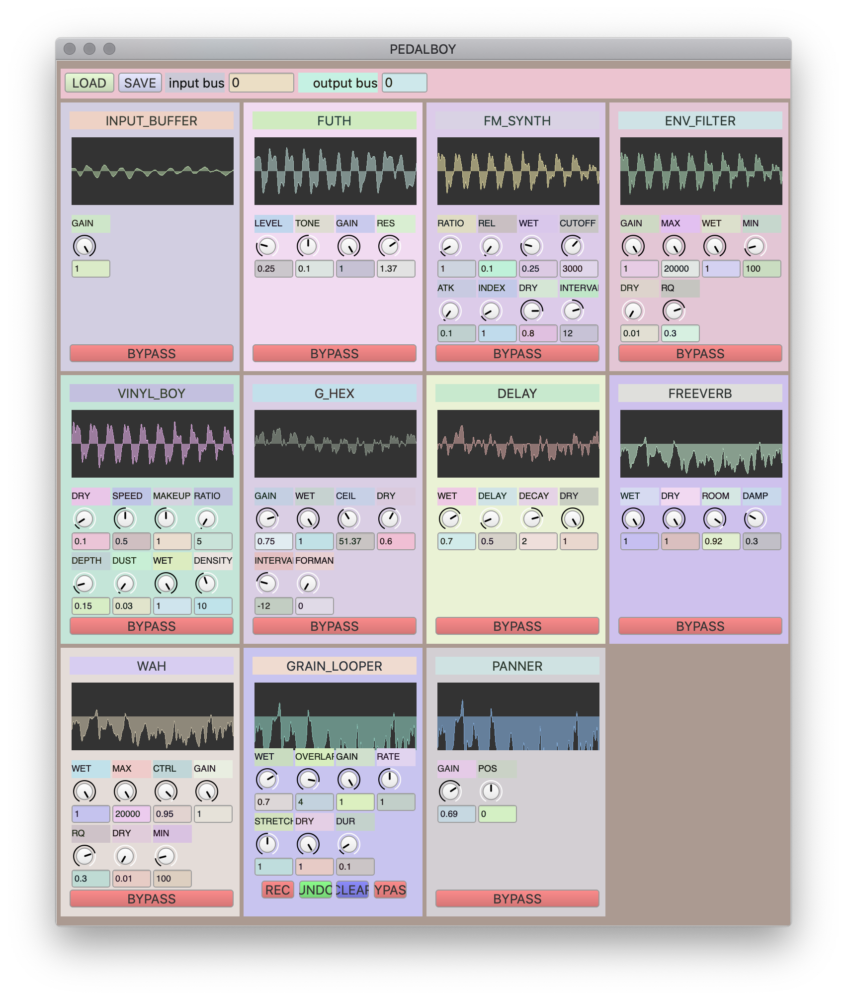
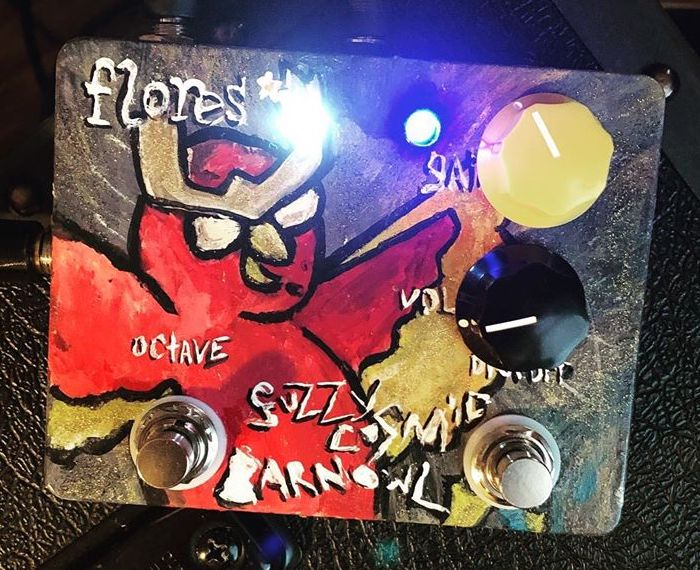

<em>the highlights (cenote, se trabó esta mierda, vaca and more) now live at <a href="https://floreselectronics.com">flores electronics</a>, the family workshop i run with my brother daniel. everything else stays here.</em>

## pedalboy (2020)

Pedalboy was my last assignment in undergrad, and it was a lot of fun to make. I made it for [Dr. John Thompson's](https://www.timebent.com) SuperCollider class. Pedalboy is a SuperCollider pedalboard with lots of lfos, lower-level controls, and midi support. Look at the code [here](https://github.com/hugofloresgarcia/pedalboy). 

## fuzzy cosmic barn owl (2019)

The fuzzy cosmic barn owl is a guitar pedal that boasts an LM386 power amp distortion with an additional analog octave up circuit.

Art by Jarrett Thompson. 